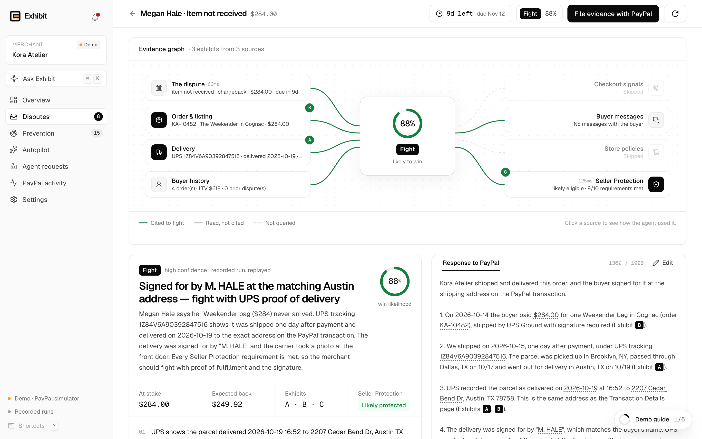
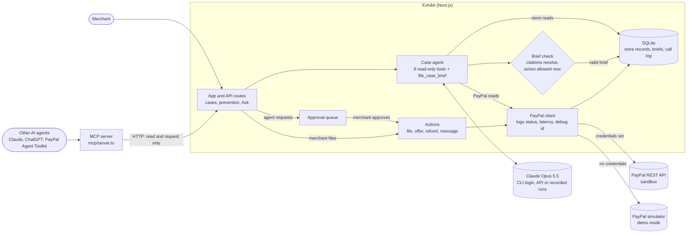

# Exhibit

**The dispute agent for PayPal merchants.** PayPal's agent tools can list, read and accept a dispute. Exhibit does the rest: Claude investigates, cites every claim and files through the Disputes API. When the buyer is right, it refunds.

Exhibit reads each dispute from PayPal's Disputes API and investigates it with Claude Opus 5.5 across eight sources: the dispute itself, the order and listing, carrier scans, the buyer's history and messages, checkout signals, store policies and PayPal's Seller Protection rules. It decides whether to fight, offer, refund or message the buyer. It writes the response to PayPal's reviewer with every claim cited to a record, and builds a PDF of lettered exhibits from those records. Nothing reaches PayPal until the merchant approves. Other AI agents can use Exhibit over MCP, but they can only ask. Built from scratch for the [PayPal AI Hackathon 2026](https://paypalaihackathon.devpost.com/) by one founder, starting with the first commit on Oct 20, 2026.



## Verified live on the PayPal sandbox

Exhibit has run end to end on `api-m.sandbox.paypal.com`. Its own log holds 244 API calls from Oct 20 to Nov 3, 2026: 240 returned 2xx and 4 returned an error, across 12 endpoints, 4 sandbox chargebacks and 13 agent runs. These are the 7 dispute responses it filed through the API:

| Dispute | Claim | Exhibit's call | Filed | HTTP | PayPal-Debug-Id |
| --- | --- | --- | --- | --- | --- |
| PP-R-EGO-10193744 | Unauthorized, $420 | Fight, 88% | `provide-evidence` | 200 | `f199340a434c8` |
| PP-R-EGO-10193744 | | | `provide-supporting-info` | 200 | `ca4d904350e86` |
| PP-R-EGO-10193744 | | | `provide-supporting-info` | 200 | `f6032251fbc7b` |
| PP-R-EGO-10193744 | | | `provide-supporting-info`, approved after an AI agent asked through MCP | 200 | `f4652162f684d` |
| PP-R-QJO-10193739 | Item not received, $284 | Fight, 80% | `provide-supporting-info` | 200 | `f559160835614` |
| PP-R-KHB-10193747 | Item not received, $68 | Refund, 3% | `accept-claim` | 200 | `f229477d6e080` |
| PP-R-XTI-10193748 | Credit not processed, $180 | Refund, 5% | `accept-claim` | 200 | `f308851883563` |

PP-R-QJO-10193739 is now `RESOLVED` (`RESOLVED_WITH_PAYOUT` / `REPRESENTED_BY_PAYPAL`) after a sandbox-only `adjudicate` call. Two earlier `provide-evidence` attempts on it failed (HTTP 400, `f193818fe828e`, and HTTP 500, `f637784337202`), which is why Exhibit now files one evidence per call.

The rows come from Exhibit's call log, exported without credentials, request bodies or buyer emails to [`proof.json`](src/components/landing/records/proof.json) by [`export.mjs`](src/components/landing/records/export.mjs). Run the app and open `/proof` to see all 244 calls with status, latency and debug id. <!-- HOSTED: link the deployed /proof page here once it is live. --> [`docs/SANDBOX_E2E.md`](docs/SANDBOX_E2E.md) has the full run, what the real API taught us, and what has not been tested live yet.

## Quick start

You need Node.js 24 or newer.

```bash
npm install
npm run dev
```

Open http://localhost:3000/app. The landing page is at `/`, the proof page at `/proof` and the pitch deck at `/pitch` (arrow keys).

Nothing needs a key:

- **The agent uses your Claude CLI login automatically.** If you are signed in to the Claude CLI, every investigation runs live on Claude Opus 5.5. Set `ANTHROPIC_API_KEY` and it runs on the Claude API instead.
- **With nothing installed, it replays recorded runs.** The recorded Claude reasoning is replayed, every tool call runs live against the case, and the recorded brief must pass the same validation as a live one.
- **Demo mode is the offline judge mode.** With no PayPal credentials, Exhibit talks to a built-in PayPal simulator with the real API's request and response shapes, error codes and file limits, for a fictional store, Kora Atelier. Exhibit's PayPal client is the same code that made the sandbox calls above. A banner and the **What's real?** dialog say what is real, simulated or recorded.

Follow the **Demo guide** (six steps that tick themselves off), or this path:

1. **Command center**: what is recovered, at risk and due next.
2. Open **Megan Hale · Item not received** and press **Run Exhibit**. The evidence graph lights up each source as the agent reads it, then wires the cited records to the verdict as lettered exhibits.
3. Read the brief and the cited **Response to PayPal**, page through the **Evidence packet** tab, then **File evidence with PayPal**. In **Simulator controls**, **Rule for merchant** closes the case.
4. **Prevention**: open Lena Hoffmann's order and send the drafted German reply before she files.
5. Press **⌘K** and ask Exhibit about the whole dispute book.
6. **Agent requests** → **Send a request as a demo agent**, then approve or reject it.
7. **PayPal activity**: every API call, with its request, response and debug id.

The demo merchant is shared by everyone using the same server. It resets itself after 20 quiet minutes, and **Reset demo** resets it now.

### Use your own PayPal sandbox

1. At [developer.paypal.com](https://developer.paypal.com/), under **Apps & Credentials** (Sandbox), create a REST app for a business account.
2. Copy [`.env.example`](.env.example) to `.env.local`, set `PAYPAL_CLIENT_ID` and `PAYPAL_CLIENT_SECRET`, and restart. The sidebar then shows the live sandbox, and **Settings → Test connection** checks OAuth and the Disputes API.
3. **Settings → Seed the sandbox** opens real chargebacks in three steps. **Create sandbox orders** makes Orders v2 orders. **Open PayPal checkout as the buyer** lets you pay each one with a [sandbox test card](https://developer.paypal.com/tools/sandbox/card-testing/) in a private window. **Capture approved & open chargebacks** captures them, opens a chargeback on each with the sandbox-only `process-chargeback` endpoint, and writes the store records the agent investigates.
4. New chargebacks move from `OPEN` to `UNDER_REVIEW`, where only `provide-supporting-info` is open, and a few minutes later to `WAITING_FOR_SELLER_RESPONSE`. Exhibit files whichever response PayPal allows at that moment.

## PayPal APIs

| Endpoint | What Exhibit uses it for | Called on the live sandbox |
| --- | --- | --- |
| `POST /v1/oauth2/token` | Client-credentials OAuth | Yes |
| `GET /v1/customer/disputes` | Inbox sync | Yes |
| `GET /v1/customer/disputes/{id}` | Case facts, deadline, requested evidence and the actions PayPal allows right now | Yes |
| `POST /v1/customer/disputes/{id}/provide-evidence` | Evidence, tracking and the PDF packet (multipart) | Yes |
| `POST /v1/customer/disputes/{id}/provide-supporting-info` | The letter and PDF packet while PayPal reviews a chargeback | Yes |
| `POST /v1/customer/disputes/{id}/accept-claim` | Refund the buyer when the records say they are right | Yes |
| `POST /v1/customer/disputes/{id}/make-offer` | Refund, return or replacement offers at the inquiry stage | Simulator only |
| `POST /v1/customer/disputes/{id}/send-message` | Messages to the buyer at the inquiry stage | Simulator only |
| `GET /v2/payments/captures/{id}` | The payment, with PayPal's own Seller Protection flag | Yes |
| `POST /v2/payments/captures/{id}/refund` | Refund first, then file the refund as proof | Simulator only |
| `POST /v2/checkout/orders/{id}/track` | Push missing tracking to PayPal before a claim (Prevention) | Simulator only |
| `POST /v1/notifications/verify-webhook-signature` | Verify `CUSTOMER.DISPUTE.*` webhooks | Simulator only |
| `POST /v2/checkout/orders`, `GET /v2/checkout/orders/{id}`, `POST /v2/checkout/orders/{id}/capture` | Seed real sandbox orders | Yes |
| `POST /v2/customer-support/process-chargeback` | Open sandbox chargebacks (sandbox only) | Yes |
| `POST /v1/customer/disputes/{id}/adjudicate` | Ask the sandbox to rule (sandbox only) | Yes |
| `POST /v1/customer/disputes/{id}/require-evidence` | Move a sandbox case to evidence-requested (sandbox only) | Simulator only |

Every call goes through one client ([`src/lib/paypal/client.ts`](src/lib/paypal/client.ts)) that logs method, path, status, latency and PayPal debug id. Secrets never reach the log.

## Architecture



```
src/app/              Routes: landing (/), proof (/proof), pitch (/pitch), the app (/app/*) and its API (/api/*)
src/lib/paypal/       client.ts (REST client, logs every call), simulator.ts (demo mode), redact.ts
src/lib/agent/        Tools, prompt, brief schema and validation, playbook and Seller Protection checks
src/lib/agent/providers/  Claude API (Anthropic SDK), Claude CLI (Claude Agent SDK), recorded-run replay
src/lib/ask/          Ask Exhibit: read-only tools, grounding checks, offline answers
src/lib/approvals.ts  The queue for requests from outside agents
src/lib/actions.ts    Runs a brief's PayPal action
src/lib/packet/       The evidence packet PDF (react-pdf), rendered from the cited records
src/lib/prevention.ts Risk scoring and fixes for orders that are not disputes yet
src/lib/store/        The demo merchant's orders, shipments, buyers, messages, risk signals and policies
mcp/                  MCP server, smoke test and the recorded agent demo
replays/              Recorded Claude runs for the no-key demo
tests/                Vitest suite
```

Data lives in SQLite (`node:sqlite`), one file per mode, under `.data/`.

## Guardrails

Each guardrail has its own tests.

- **Every claim cites a record that exists.** Each tool result carries evidence refs such as `shipment:SHP-10482`. A brief is rejected unless every ref resolves to a record on that case, and the evidence packet re-reads each record from source. The model chooses the evidence; it cannot write it. Tests: [`citation-guardrail`](tests/citation-guardrail.test.ts).
- **Only actions PayPal allows right now.** A brief is rejected if its action is not among the dispute's current HATEOAS links, or if its offer type or amount is outside what the dispute allows. Tests: [`action-guardrail`](tests/action-guardrail.test.ts).
- **An agent can ask, never do.** MCP tools can investigate and request. A request only creates a pending approval. The merchant decides in the app, which accepts a decision only from a same-origin request. A request expires if the case is re-investigated before the merchant approves. Tests: [`approvals`](tests/approvals.test.ts), [`approvals-api`](tests/approvals-api.test.ts), [`mcp-server`](tests/mcp-server.test.ts).
- **Filings call PayPal the way PayPal accepts them.** Only the evidence types PayPal requested, one evidence per call, and supporting info while PayPal reviews a chargeback. Tests: [`filing`](tests/filing.test.ts).
- **The simulator behaves like PayPal.** Request and response shapes, error codes, file limits and the actions open at each stage. Tests: [`simulator`](tests/simulator.test.ts).
- **Autopilot stays inside explicit limits.** It is off by default, sends every low-confidence brief to a person, has hard limits no saved setting can raise, and never acts on a run an outside agent started. Tests: [`autopilot`](tests/autopilot.test.ts), [`agent-run`](tests/agent-run.test.ts).
- **The agent can look, not touch.** Its tools only read. On the Claude CLI it gets Exhibit's tools and nothing else: no shell, no files, no other MCP servers, no user settings. Tests: [`agent-tools`](tests/agent-tools.test.ts).
- **Ask Exhibit only says what the data says.** It is read-only, and an answer that names a dispute or order that does not exist, or charts a number no tool returned, is sent back. Tests: [`ask-grounding`](tests/ask-grounding.test.ts).
- **Fair to buyers.** The playbook refunds or offers when the merchant is at fault, and the Seller Protection check quotes PayPal's published US requirements. Tests: [`playbook`](tests/playbook.test.ts).
- **Prevention scores and fixes orders as documented.** Seven warning signs, each tied to the dispute reason it leads to. Tests: [`prevention`](tests/prevention.test.ts).
- **The no-key demo works.** Recorded runs replay on every demo case and pass validation. Tests: [`replays`](tests/replays.test.ts), [`config`](tests/config.test.ts).

## Use Exhibit from any AI agent (MCP)

Exhibit ships an MCP server, so Claude, ChatGPT or an agent built on PayPal's [Agent Toolkit](https://github.com/paypal/agent-toolkit) can triage and prepare disputes. PayPal's [agent tools](https://developer.paypal.com/ai-tools/agent-tools/) offer `list_disputes`, `get_dispute` and `accept_dispute_claim`. Exhibit adds the investigation, the evidence and the filing, and it never moves money without the merchant.

```bash
npm run dev                                       # Exhibit must be running
EXHIBIT_URL=http://localhost:3000 npm run mcp     # stdio server: node mcp/server.ts
```

Claude Code: `claude mcp add exhibit -e EXHIBIT_URL=http://localhost:3000 -- node /path/to/exhibit/mcp/server.ts`. For Claude Desktop, **Settings → Connect an AI agent** shows a config with your paths filled in, next to PayPal's own MCP server.

| Tool | What it does |
| --- | --- |
| `list_disputes` | Open cases with Exhibit's call and win likelihood |
| `investigate_dispute` | Runs the Exhibit agent and returns the brief |
| `get_case_brief` | The latest brief, without a new run |
| `get_evidence_packet` | The URL of the PDF evidence packet |
| `get_prevention_report` | Orders likely to become disputes, with risk scores and fixes |
| `get_overview` | Recovered, at risk, win rate and dispute rate |
| `request_dispute_action` | Queues the brief's PayPal action for the merchant's approval |
| `request_prevention_fix` | Queues a prevention fix for the merchant's approval |
| `get_approval_status` | Pending, approved (with PayPal's result), rejected, failed or expired |

Plus a resource (`exhibit://disputes/open`) and a prompt (`triage_disputes`). No tool files with PayPal, moves money or messages a buyer. When the merchant approves a request, Exhibit runs the same code as the merchant's own button and logs it under the agent's name.

> "Authorization is checked again before a selected tool is executed."
>
> PayPal Developer Blog, [What We Learned Building PayPal's MCP Gateway](https://developer.paypal.com/community/blog/PayPal_MCP_Gateway), PayPal Cosmos.AI Agentic Platform Team, Oct 8, 2026

Exhibit holds money to the same rule. When the merchant approves, it re-reads the dispute from PayPal and checks the request still matches the latest brief. If the brief has changed, the request expires.

[`docs/MCP_DEMO.md`](docs/MCP_DEMO.md) is a recorded run: Claude Opus 5.5 with only Exhibit's MCP server attached triaged 8 open disputes in 57 s and queued the strongest for approval. `npm run mcp:smoke` calls every tool against a demo-mode server and approves one request end to end.

## Tests and CI

```bash
npm test            # 300 tests, no credentials needed
npm run lint        # ESLint
npm run typecheck   # tsc --noEmit
npm run build       # next build
```

The suite in [`tests/`](tests) is organised around the guardrails above. It forces demo mode and recorded runs, uses a temporary data directory and blocks outbound network calls, so it needs no keys, no network and no Claude login. [`.github/workflows/ci.yml`](.github/workflows/ci.yml) runs lint, typecheck, tests and build on every push and pull request to `main`, with no secrets.

## Evaluation

**30 of 30 decisions matched the label** on 30 synthetic disputes across seven reasons, at the inquiry stage, the chargeback stage and under PayPal review. Exhibit refunded all 9 cases where the buyer was right instead of fighting them, made 0 false fights out of 18, and all 30 briefs passed the citation and action guardrails. The median case took 29 s from start to a validated brief.

It was one live run of Claude Opus 5.5 on the Claude CLI against the simulator, on Nov 3, 2026, with the labels frozen and hashed before the run. The builder wrote the cases and labels, with Claude, so this shows Exhibit applies its rules consistently, not how accurate it is on real disputes. Method, results and limitations: [`eval/RESULTS.md`](eval/RESULTS.md).

## Known limitations

- **Shared demo state.** Everyone on the same server works the same demo merchant, so one visitor's filing or fix changes what the next one sees until the demo resets (after 20 quiet minutes, or with **Reset demo**).
- **`make-offer` and `send-message` are verified only on the simulator.** PayPal allows them only at the inquiry stage. Sandbox chargebacks from `process-chargeback` skip that stage, and opening a buyer-side inquiry needs PayPal partner consent.
- **Tracking push and capture refunds are verified only on the simulator.** Both are implemented and tested, but have not been called on the live sandbox.
- **Webhooks need a public HTTPS URL.** Nothing is deployed yet, so PayPal has not delivered a webhook to Exhibit. Signature checks use PayPal's `verify-webhook-signature` API and run in the simulator.
- **Simulated disputes reuse recorded text.** **Simulate new dispute** copies the Megan Hale item-not-received case with new ids. On recorded runs, its brief is that case's recorded reasoning.
- **No store or carrier connectors yet.** Order, carrier, inbox and checkout records come from the built-in demo store, also in sandbox mode. Shopify, WooCommerce and carrier APIs are next.
- **Sandbox outcomes are not PayPal decisions on the merits.** The one resolved case closed after a sandbox-only `adjudicate` call.
- **No sign-in yet.** Exhibit is a single-merchant app. Do not expose a deployment with live PayPal credentials until authentication sits in front of it (see [`SECURITY.md`](SECURITY.md)).

## Environment variables

Everything is optional. Copy [`.env.example`](.env.example) to `.env.local`.

| Variable | Purpose |
| --- | --- |
| `PAYPAL_CLIENT_ID`, `PAYPAL_CLIENT_SECRET` | Sandbox REST app credentials. Without both, Exhibit runs in demo mode on the simulator. |
| `PAYPAL_WEBHOOK_ID` | The webhook id from the app's sandbox webhooks, to verify signatures |
| `ANTHROPIC_API_KEY` | Run the agent and Ask Exhibit on the Claude API. Takes precedence over a Claude CLI login. |
| `EXHIBIT_MODEL` | Model id (default `claude-opus-5-5`) |
| `EXHIBIT_APP_URL` | This app's public URL, shown as the webhook listener in Settings |
| `EXHIBIT_ALLOW_CLAUDE_CODE=0` | Ignore the local Claude CLI login and replay recorded runs |
| `EXHIBIT_AI_PROVIDER` | Force a provider: `anthropic`, `claude-code` or `replay` |
| `EXHIBIT_PAYPAL_MODE=demo` | Stay in demo mode even when PayPal credentials are set |
| `EXHIBIT_DATA_DIR` | Where the SQLite files go (default `.data/`) |
| `EXHIBIT_RECORD_REPLAYS=1` | Development: save live runs to `replays/` |
| `EXHIBIT_URL` | For the MCP server: the address of the running app (default `http://localhost:3000`) |

## Team

Built by Shivansh Dwivedi and Someet Shende, Exhibit's co-founders, for the PayPal AI Hackathon 2026.

## License

[MIT](LICENSE). Geist and Geist Mono are used under the SIL Open Font License.

Exhibit is an independent project. It is not affiliated with or endorsed by PayPal. PayPal is a trademark of PayPal, Inc. Kora Atelier, the demo merchant, is fictional.
