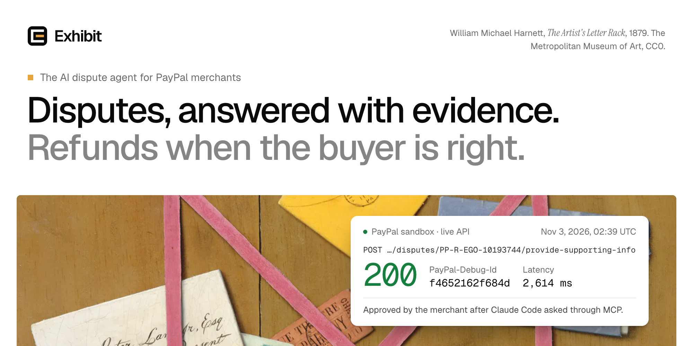
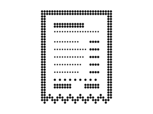
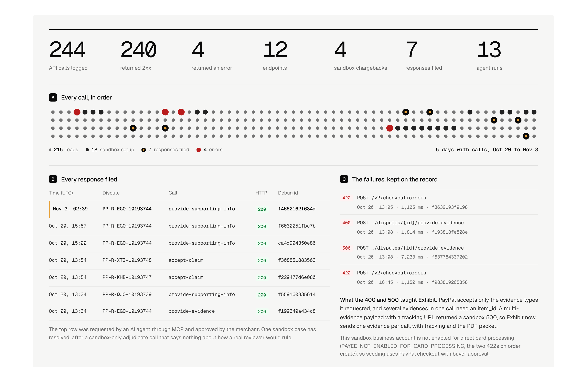
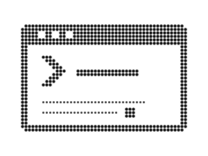
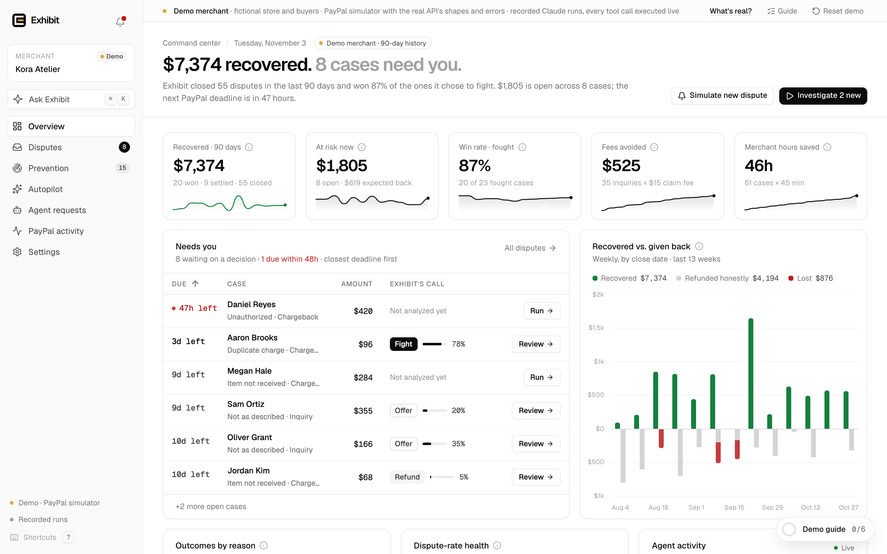
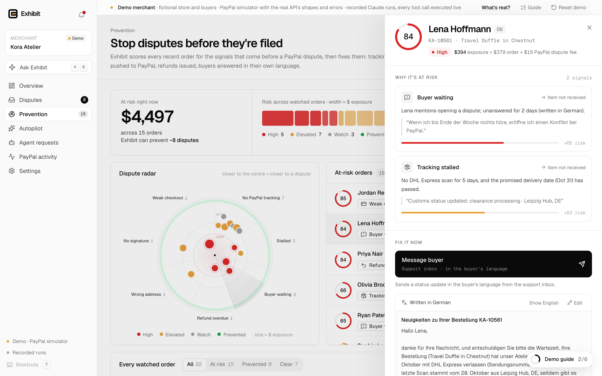
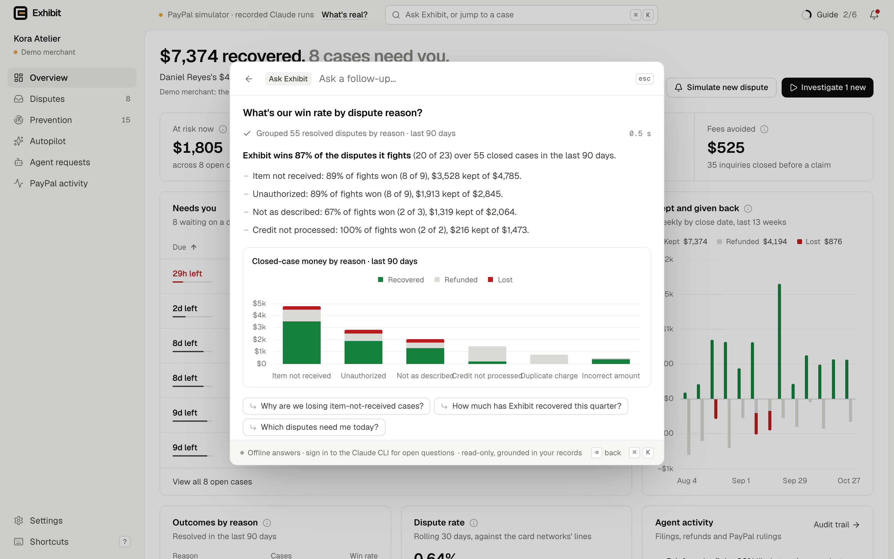
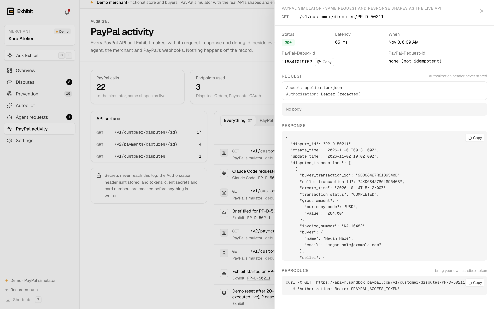
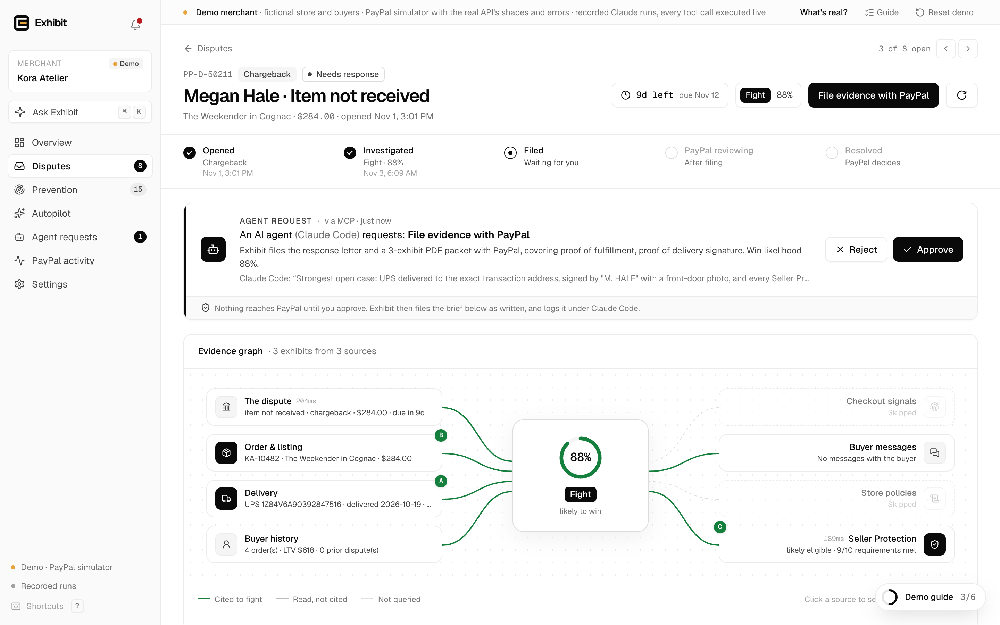
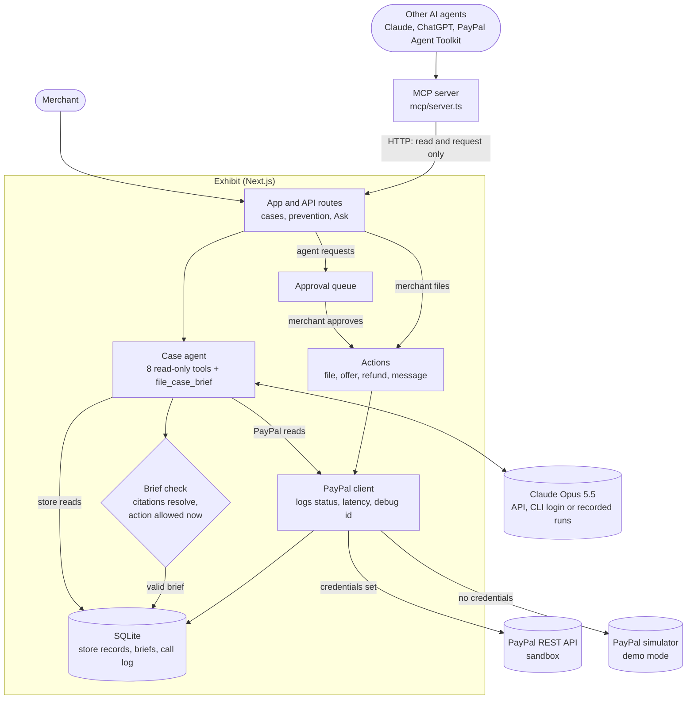

<p align="center">
  <picture>
    <source media="(prefers-color-scheme: dark)" srcset="docs/brand/readme-hero-dark.png">
    
  </picture>
</p>

<p align="center">
  <b>PayPal's agent tools can list, read and accept a dispute. Exhibit does the rest.</b><br>
  Claude investigates, cites every claim and files through the Disputes API. When the buyer is right, it refunds.
</p>

<p align="center">
  <a href="#verified-live-on-the-paypal-sandbox">Sandbox proof</a> ·
  <a href="#run-it-with-no-keys">Run it</a> ·
  <a href="#for-judges">For judges</a> ·
  <a href="#how-it-works">How it works</a> ·
  <a href="#architecture">Architecture</a>
  <!-- VIDEO_URL -->
</p>

<p align="center">
  <a href="LICENSE"></a>
  <a href=".nvmrc"></a>
  <a href="#tests-and-ci"></a>
</p>

Exhibit is an AI dispute agent for merchants who sell through PayPal. It reads each dispute and chargeback from **PayPal's Disputes API** and investigates it with **Claude Opus 5.5** across eight sources: the dispute itself, the order and listing, carrier scans, the buyer's history and messages, checkout signals, store policies and PayPal's Seller Protection rules. It decides whether to fight, offer, refund or message the buyer, and writes the response to PayPal's reviewer with every claim cited to a record.

When the merchant approves, Exhibit files through the Disputes API, and when the buyer is right, it refunds. It also uses **Orders v2**, **Payments v2** and **webhook signature verification**. Other AI agents can use Exhibit over **MCP**, but they can only ask.

Built from scratch for the [PayPal AI Hackathon 2026](https://paypalaihackathon.devpost.com/) by its two co-founders, [Shivansh Dwivedi](https://github.com/shvuuuu) and [Someet Shende](https://github.com/someetshende), during the Submission Period: the first commit is Oct 20, 2026, and the whole history is public. MIT licensed.

<br>

<p align="center">
  <picture>
    <source media="(prefers-color-scheme: dark)" srcset="docs/brand/dots/receipt-on-dark.svg">
    
  </picture>
</p>

## Verified live on the PayPal sandbox

<!-- records:proof: generated from src/components/landing/records/proof.json by node docs/brand/readme-facts.mjs. Edit the script, not this block. -->
Exhibit has run end to end on `api-m.sandbox.paypal.com`. Its own call log holds **244 API calls** from Oct 20 to Nov 3, 2026: 240 returned 2xx and 4 returned an error, across 12 endpoints, 4 sandbox chargebacks and 13 agent runs. These are the **7 dispute responses** it filed through the Disputes API:

<table>
<thead><tr><th align="left">Dispute</th><th align="left">Exhibit's call</th><th align="left">Filed</th><th align="left">HTTP</th><th align="left">PayPal-Debug-Id</th></tr></thead>
<tbody>
<tr><td rowspan="4">PP-R-EGO-10193744<br><sub>Unauthorized, $420</sub></td><td rowspan="4">Fight, 88%</td><td><code>provide-evidence</code></td><td>200</td><td><code>f199340a434c8</code></td></tr>
<tr><td><code>provide-supporting-info</code></td><td>200</td><td><code>ca4d904350e86</code></td></tr>
<tr><td><code>provide-supporting-info</code></td><td>200</td><td><code>f6032251fbc7b</code></td></tr>
<tr><td><code>provide-supporting-info</code><br><sub>requested by an AI agent</sub></td><td>200</td><td><code>f4652162f684d</code></td></tr>
<tr><td>PP-R-QJO-10193739<br><sub>Item not received, $284</sub></td><td>Fight, 80%</td><td><code>provide-supporting-info</code></td><td>200</td><td><code>f559160835614</code></td></tr>
<tr><td>PP-R-KHB-10193747<br><sub>Item not received, $68</sub></td><td>Refund, 3%</td><td><code>accept-claim</code></td><td>200</td><td><code>f229477d6e080</code></td></tr>
<tr><td>PP-R-XTI-10193748<br><sub>Credit not processed, $180</sub></td><td>Refund, 5%</td><td><code>accept-claim</code></td><td>200</td><td><code>f308851883563</code></td></tr>
</tbody>
</table>

**The agent-requested filing.** On Nov 3, 2026, at 02:39 UTC, an outside AI agent (Claude Code, connected through Exhibit's MCP server) asked to file on PP-R-EGO-10193744. Nothing moved until the merchant approved. Then Exhibit called `provide-supporting-info`, and PayPal answered 200 in 2,614 ms.

**The rest of the record.** PP-R-QJO-10193739 is now `RESOLVED` (`RESOLVED_WITH_PAYOUT` / `REPRESENTED_BY_PAYPAL`) after a sandbox-only `adjudicate` call (`f390262856e3a`). Two earlier `provide-evidence` attempts on it failed (HTTP 400, `f193818fe828e`; HTTP 500, `f637784337202`), which is why Exhibit now files one evidence per call.
<!-- /records:proof -->

Every row comes from Exhibit's own call log, exported without credentials, request bodies or buyer emails to [`proof.json`](src/components/landing/records/proof.json) by [`export.mjs`](src/components/landing/records/export.mjs). Run the app and open `/proof` to see every call with its status, latency and debug id. [`docs/SANDBOX_E2E.md`](docs/SANDBOX_E2E.md) has the full run, what the real API taught us, and what has not been tested live yet.

<p align="center">
  
</p>
<p align="center"><sub>The proof board on Exhibit's website, drawn from the same records: one dot per logged call, every filing with its debug id, and every failure.</sub></p>

<br>

<p align="center">
  <picture>
    <source media="(prefers-color-scheme: dark)" srcset="docs/brand/dots/scales-on-dark.svg">
    
  </picture>
</p>

## For judges

Exhibit against the five equally weighted criteria, with the evidence for each.

- **Technological Implementation.** Disputes API write endpoints called live on the sandbox, each with its PayPal debug id ([the record](#verified-live-on-the-paypal-sandbox), [the full run](docs/SANDBOX_E2E.md)). A Claude Opus 5.5 agent whose brief is rejected unless every citation resolves to a real record and the action is one PayPal allows on the case right now ([guardrails](#guardrails)). 300 tests that need no keys ([tests](#tests-and-ci)).
- **Design.** A complete product: a command center, an inbox with saved views, a case page with a live evidence graph and a cited letter, the evidence packet PDF, prevention, Autopilot, agent approvals, a PayPal API inspector and a ⌘K question palette ([how it works](#how-it-works)). The website and docs run in the same app.
- **Potential Impact.** Every dispute can carry a PayPal fee: $15, $30 for high-volume sellers, $20 per card chargeback ([PayPal's fees](https://www.paypal.com/us/business/paypal-business-fees)). Exhibit fights what the records support, refunds what they don't, and stops disputes before they are filed. On 30 synthetic disputes, its decision matched the label 30 of 30 times, to be read with its caveat ([evaluation](#evaluation)).
- **Innovation/Idea.** PayPal's agent tools can read a dispute or concede it. Exhibit adds the investigation, the evidence and the filing, and lets other agents use them under the rule PayPal applies to its own MCP gateway: agents request, merchants approve ([the toolkit gap](#paypals-agent-toolkit-and-exhibit), [MCP](#use-exhibit-from-any-ai-agent-mcp)).
- **Presentation.** The demo video<!-- VIDEO_URL -->, this page, and a repository that runs with no keys ([run it](#run-it-with-no-keys), [what the video shows](#what-the-demo-video-shows)).

<br>

<p align="center">
  <picture>
    <source media="(prefers-color-scheme: dark)" srcset="docs/brand/dots/terminal-on-dark.svg">
    
  </picture>
</p>

## Run it with no keys

**Offline judge mode: no keys, accounts or credentials.** You need Node.js 24 or newer (the version is in [`.nvmrc`](.nvmrc)) and npm, on macOS, Linux or Windows.

```bash
git clone https://github.com/exhibitlabs/exhibit.git
cd exhibit
npm install
npm run dev
```

Open **http://localhost:3000/app**. The website runs in the same app at http://localhost:3000, with the docs at `/docs` and the sandbox record at `/proof`.

With nothing configured:

- **PayPal runs on a built-in simulator.** Without PayPal credentials, Exhibit talks to a simulator with the real API's request and response shapes, error codes and file limits, for a fictional store, Kora Atelier. It is the same PayPal client that made the sandbox calls above. A banner and the **What's real?** dialog say what is real, simulated or recorded. Add sandbox credentials and the same code calls PayPal ([below](#use-your-own-paypal-sandbox)).
- **The agent runs on Claude if it can.** It uses `ANTHROPIC_API_KEY` if that is set, otherwise your Claude CLI login, so if you are signed in to the Claude CLI every investigation runs live on Claude Opus 5.5. With neither, it replays recorded Claude runs: the recorded reasoning is replayed, every tool call runs live against the case, and the brief must pass the same checks as a live one.

This mode exists so judges can try every screen without keys. The product is the live path: the same code filed the sandbox responses above.

### Testing steps

The demo guide, under **Guide** in the top bar (and as a strip on the command center on your first visit), walks through six steps and ticks each one off as the real work lands. The same path by hand:

1. **Command center** (`/app`): what is recovered, at risk and due next.
2. Open the case for **Megan Hale** (item not received) and press **Run Exhibit**. The evidence graph lights up each source as the agent reads it, then wires the cited records to the verdict as lettered exhibits.
3. Read the brief and the cited **Response to PayPal**, page through the **Evidence packet** tab, then press **File evidence with PayPal**. Under **Simulator controls**, **Rule for the merchant** closes the case.
4. **Prevention**: open Lena Hoffmann's order and send the drafted German reply before she files.
5. Press **⌘K** (Ctrl+K on Windows and Linux) and ask about the whole dispute book.
6. **Agent requests** → **Send a request as a demo agent**, then approve or reject it.
7. **PayPal activity**: every API call, with its request, response and debug id.

Everyone on the same server shares the demo merchant. It resets itself after 20 quiet minutes, and **Reset demo** resets it now. `npm test` runs the test suite with no keys and no network.

<p align="center">
  
</p>
<p align="center"><sub>The command center, where the app opens. Demo merchant: a fictional store on the PayPal simulator, with a generated 90-day history.</sub></p>

### Use your own PayPal sandbox

1. At [developer.paypal.com](https://developer.paypal.com/), under **Apps & Credentials** (Sandbox), create a REST app for a business account.
2. Copy [`.env.example`](.env.example) to `.env.local`, set `PAYPAL_CLIENT_ID` and `PAYPAL_CLIENT_SECRET`, and restart. The sidebar then shows the live sandbox, and **Settings → Test connection** checks OAuth and the Disputes API.
3. **Settings → Seed the sandbox** opens real chargebacks in three steps. **Create sandbox orders** makes Orders v2 orders. **Open PayPal checkout as the buyer** lets you pay each one with a [sandbox test card](https://developer.paypal.com/tools/sandbox/card-testing/) in a private window. **Capture approved & open chargebacks** captures them, opens a chargeback on each with the sandbox-only `process-chargeback` endpoint, and writes the store records the agent investigates.
4. New chargebacks move from `OPEN` to `UNDER_REVIEW`, where only `provide-supporting-info` is open, and a few minutes later to `WAITING_FOR_SELLER_RESPONSE`. Exhibit files whichever response PayPal allows at that moment.

## What the demo video shows

<!-- VIDEO_URL -->Each part of the demo video maps to code in this repository.

- **A live sandbox chargeback**, read from PayPal's Disputes API, with its lifecycle and evidence graph: [`src/lib/paypal/client.ts`](src/lib/paypal/client.ts), [`src/components/app/case/`](src/components/app/case)
- **Claude investigates the case** and decides to fight, citing every claim: [`src/lib/agent/`](src/lib/agent) ([`tools.ts`](src/lib/agent/tools.ts), [`prompt.ts`](src/lib/agent/prompt.ts), [`run.ts`](src/lib/agent/run.ts) and the three [`providers`](src/lib/agent/providers))
- **Hovering a claim lights the record it cites**: [`brief.ts`](src/lib/agent/brief.ts) (citation checks), [`CitedText.tsx`](src/components/app/case/CitedText.tsx), [`EvidenceGraph.tsx`](src/components/app/case/EvidenceGraph.tsx)
- **An outside AI agent asks over MCP** to file the evidence: [`mcp/server.ts`](mcp/server.ts), [`mcp/agent-demo.ts`](mcp/agent-demo.ts), [`src/lib/approvals.ts`](src/lib/approvals.ts)
- **The merchant approves, and Exhibit files with PayPal**, with HTTP 200 and a debug id: [`src/lib/actions.ts`](src/lib/actions.ts), [`AgentApprovals.tsx`](src/components/app/AgentApprovals.tsx), [`ApiInspector.tsx`](src/components/app/ApiInspector.tsx)
- **A case where the buyer is right**, and Exhibit accepts the claim: [`src/lib/agent/playbook.ts`](src/lib/agent/playbook.ts)
- **Prevention**, a reply in German before the buyer files: [`src/lib/prevention.ts`](src/lib/prevention.ts), [`PreventionView.tsx`](src/components/app/PreventionView.tsx)
- **Ask Exhibit** answers about the whole dispute book, with a chart: [`src/lib/ask/`](src/lib/ask), [`AskPalette.tsx`](src/components/app/ask/AskPalette.tsx)
- **The evaluation**, with its caveat: [`eval/`](eval)

<br>

<p align="center">
  <picture>
    <source media="(prefers-color-scheme: dark)" srcset="docs/brand/dots/magnifier-on-dark.svg">
    
  </picture>
</p>

## How it works

1. **A dispute arrives.** PayPal's `CUSTOMER.DISPUTE.CREATED` webhook starts the agent on it, or the merchant does with one click, on one case or on every new case at once.
2. **Exhibit investigates.** Claude Opus 5.5 reads the live dispute from PayPal (reason, stage, deadline, the evidence PayPal requested and the actions it allows now), then the order and listing, carrier scans, the buyer's history, the support inbox, checkout risk signals and store policies, and checks the case against PayPal's published US Seller Protection requirements, quoted word for word.
3. **It decides.** Fight, offer, refund or message the buyer, with a win likelihood and reasoning in which every point cites a record.
4. **Code checks the brief.** It is rejected unless every citation resolves to a record on that case and the action is one PayPal allows right now.
5. **The merchant approves, and Exhibit files.** The letter and a PDF of lettered exhibits, rendered from the records and never from the model's text, go to PayPal through whichever call it allows at that moment. Autopilot is off by default; when it is on, it acts only inside the merchant's limits.
6. **When the buyer is right, it refunds.** On the sandbox it refused to fight two chargebacks: a wallet that came back to the store undelivered, and a return that arrived but was never refunded.

<p align="center">
  
</p>
<p align="center"><sub>A case: the evidence graph, Exhibit's brief and the response to PayPal, every claim cited to a lettered exhibit. Demo merchant, recorded run.</sub></p>

Around the case page:

- **Prevention.** A radar scores recent orders for seven warning signs, such as tracking that never reached PayPal, a stalled parcel or a buyer waiting on a reply, and fixes them before anyone files: tracking pushed to PayPal, refunds, replies in the buyer's language.
- **Ask Exhibit.** Press ⌘K and ask about the whole dispute book. It answers from read-only tools, and an answer that names a case that does not exist, or charts a number no tool returned, is sent back.
- **Agent requests.** Other AI agents investigate and request over MCP; the merchant approves or rejects each request in the app.
- **PayPal activity.** Every PayPal call is logged with its request, response, latency and debug id, next to every decision by the agent, the merchant and PayPal's webhooks.

<p align="center">
  
</p>
<p align="center"><sub>Prevention: a buyer warns in German that she will open a PayPal dispute, and Exhibit drafts the reply in German first. Demo merchant.</sub></p>

<p align="center">
  
</p>
<p align="center"><sub>Ask Exhibit answers from read-only tools, with its chart. Demo merchant, offline answers.</sub></p>

## PayPal APIs

### PayPal's agent toolkit and Exhibit

PayPal's [agent tools](https://developer.paypal.com/ai-tools/agent-tools/) offer three dispute tools: `list_disputes`, `get_dispute` and `accept_dispute_claim`, which resolves a case "in favor of the buyer." An agent built on them can read a dispute or concede it. Exhibit does the work in between, and it can be one of the tools an agent like that calls.

| Step | PayPal's agent tools | Exhibit |
| :--- | :--- | :--- |
| Read the dispute | `list_disputes`, `get_dispute` | Disputes API, plus the actions PayPal allows on the case right now |
| Investigate the order, carrier, buyer, checkout and policies | | Read-only tools over the store's records |
| Check Seller Protection | | PayPal's published US requirements, quoted |
| Decide: fight, offer, refund or message the buyer | | A brief with a win likelihood and cited reasoning |
| Write the response and the evidence packet | | A letter and a PDF of lettered exhibits, rendered from the records |
| File evidence | | `provide-evidence`, or<br>`provide-supporting-info` while PayPal reviews |
| Offer a refund or replacement, or message the buyer | | `make-offer`, `send-message` |
| Concede when the buyer is right | `accept_dispute_claim` | `accept-claim`, or refund the capture and file the refund as proof |
| Prevent the dispute before it is filed | | Tracking pushed to PayPal, replies, refunds |
| Ask a person before money moves | | Every agent request waits for the merchant |

### Endpoints

Paths that start with `…/disputes/{id}` are under `/v1/customer/disputes/{id}`. "(sandbox)" marks endpoints that exist only in PayPal's sandbox.

| Endpoint | Used for | Live sandbox |
| :--- | :--- | :--- |
| `POST /v1/oauth2/token` | Client-credentials OAuth | Yes |
| `GET /v1/customer/disputes` | Inbox sync | Yes |
| `GET /v1/customer/disputes/{id}` | Case facts, allowed actions | Yes |
| `POST …/disputes/{id}/provide-evidence` | Evidence and the PDF packet | Yes |
| `POST …/disputes/{id}/provide-supporting-info` | Filing while PayPal reviews | Yes |
| `POST …/disputes/{id}/accept-claim` | Refund when the buyer is right | Yes |
| `POST …/disputes/{id}/make-offer` | Offers at the inquiry stage | Simulator only |
| `POST …/disputes/{id}/send-message` | Messages at the inquiry stage | Simulator only |
| `GET /v2/payments/captures/{id}` | Seller Protection flag | Yes |
| `POST /v2/payments/captures/{id}/refund` | Refund, then file the proof | Simulator only |
| `POST /v2/checkout/orders/{id}/track` | Push tracking before a claim | Simulator only |
| `POST /v1/notifications/verify-webhook-signature` | Verify dispute webhooks | Simulator only |
| `POST /v2/checkout/orders`<br>`GET /v2/checkout/orders/{id}`<br>`POST /v2/checkout/orders/{id}/capture` | Seed sandbox orders | Yes |
| `POST /v2/customer-support/process-chargeback` | Open chargebacks (sandbox) | Yes |
| `POST …/disputes/{id}/adjudicate` | Ask the sandbox to rule | Yes |
| `POST …/disputes/{id}/require-evidence` | Request evidence (sandbox) | Simulator only |

Every call goes through one client, [`src/lib/paypal/client.ts`](src/lib/paypal/client.ts), which logs method, path, status, latency and PayPal debug id. Secrets never reach the log. The simulator, [`src/lib/paypal/simulator.ts`](src/lib/paypal/simulator.ts), implements the same endpoints with PayPal's shapes, error codes and limits.

<p align="center">
  
</p>
<p align="center"><sub>PayPal activity with the API inspector open: status, latency, debug id, the redacted request, the response and a sandbox curl. Demo merchant, PayPal simulator.</sub></p>

## The AI: Claude Opus 5.5

- **The case agent** is Claude Opus 5.5 (`claude-opus-5-5`, set with `EXHIBIT_MODEL`) with adaptive thinking. It calls eight read-only tools and files a structured brief with a ninth, `file_case_brief`: the decision, win likelihood, cited reasoning, lettered exhibits, the PayPal action and the response letter.
- **Three providers behind one tool interface.** With `ANTHROPIC_API_KEY` set, it runs on the Claude API through the Anthropic SDK in a streaming tool loop. Otherwise it runs on the local Claude CLI login through the Claude Agent SDK, with Exhibit's tools and nothing else: no shell, no files, no other MCP servers. With neither, recorded Claude runs replay and every tool call still executes live.
- **Ask Exhibit** uses the same model and providers with read-only tools. With no Claude login or key, it falls back to a fixed set of offline answers and says so.
- **The MCP demo** in [`docs/MCP_DEMO.md`](docs/MCP_DEMO.md) is Claude Opus 5.5, through the Claude Agent SDK, with Exhibit's MCP server as its only tool.

## Use Exhibit from any AI agent (MCP)

Exhibit ships an MCP server, so Claude, ChatGPT or an agent built on PayPal's [Agent Toolkit](https://github.com/paypal/agent-toolkit) can triage and prepare disputes. It never moves money without the merchant.

```bash
npm run dev                                       # Exhibit must be running
EXHIBIT_URL=http://localhost:3000 npm run mcp     # stdio server: node mcp/server.ts
```

To add it to Claude Code:

```bash
claude mcp add exhibit -e EXHIBIT_URL=http://localhost:3000 -- node /path/to/exhibit/mcp/server.ts
```

For Claude Desktop, **Settings → Connect an AI agent** in the app shows a config with your paths filled in, next to PayPal's own MCP server.

| Tool | What it does |
| :--- | :--- |
| `list_disputes` | Open cases with Exhibit's call and win likelihood |
| `investigate_dispute` | Runs the Exhibit agent and returns the brief |
| `get_case_brief` | The latest brief, without a new run |
| `get_evidence_packet` | The URL of the PDF evidence packet |
| `get_prevention_report` | Orders likely to become disputes, with risk scores and fixes |
| `get_overview` | Recovered, at risk, win rate and dispute rate |
| `request_dispute_action` | Queues the brief's PayPal action for the merchant's approval |
| `request_prevention_fix` | Queues a prevention fix for the merchant's approval |
| `get_approval_status` | Pending, approved (with PayPal's result), rejected, failed or expired |

Plus a resource (`exhibit://disputes/open`) and a prompt (`triage_disputes`). No tool files with PayPal, moves money or messages a buyer. When the merchant approves a request, Exhibit runs the same code as the merchant's own button and logs it under the agent's name.

> "Authorization is checked again before a selected tool is executed."
>
> PayPal Developer Blog, [What We Learned Building PayPal's MCP Gateway](https://developer.paypal.com/community/blog/PayPal_MCP_Gateway), PayPal Cosmos.AI Agentic Platform Team, Oct 8, 2026

Exhibit holds money to the same rule. When the merchant approves, it re-reads the dispute from PayPal and checks the request still matches the latest brief. If the brief has changed, the request expires.

[`docs/MCP_DEMO.md`](docs/MCP_DEMO.md) is a recorded run: Claude Opus 5.5 with only Exhibit's MCP server attached triaged 8 open disputes in 57 s and queued the strongest for approval. `npm run mcp:smoke` calls every tool against a demo-mode server and approves one request end to end.

<p align="center">
  
</p>
<p align="center"><sub>An outside AI agent (Claude Code, over MCP) asks to file evidence with PayPal. Nothing is sent until the merchant approves. Demo merchant.</sub></p>

## Architecture



```
src/app/(site)/           The website: home, /proof, /product, /security, /pricing, /about, /contact,
                          /docs and legal pages
src/app/app/              The app (/app): command center, inbox, case pages, prevention, Autopilot,
                          agent requests, PayPal activity, settings
src/app/api/              The app's API, including the PayPal webhook listener
src/lib/paypal/           client.ts (REST client, logs every call), simulator.ts (demo mode), redact.ts
src/lib/agent/            Tools, prompt, brief schema and checks, playbook, Seller Protection rules
src/lib/agent/providers/  Claude API (Anthropic SDK), Claude CLI (Claude Agent SDK), recorded runs
src/lib/ask/              Ask Exhibit: read-only tools, grounding checks, offline answers
src/lib/approvals.ts      The queue for requests from outside agents
src/lib/actions.ts        Runs a brief's PayPal action
src/lib/packet/           The evidence packet PDF (react-pdf), rendered from the cited records
src/lib/prevention.ts     Risk scoring and fixes for orders that are not disputes yet
src/lib/store/            The demo merchant's orders, shipments, buyers, messages and policies
src/content/docs/         The docs, in Markdown (served at /docs)
mcp/                      MCP server, smoke test and the recorded agent demo
replays/                  Recorded Claude runs for the no-key demo
eval/                     The evaluation: cases, labels, harness and results
tests/                    Vitest suite
```

Data lives in SQLite (`node:sqlite`), one file per mode, under `.data/`.

<br>

<p align="center">
  <picture>
    <source media="(prefers-color-scheme: dark)" srcset="docs/brand/dots/shield-on-dark.svg">
    
  </picture>
</p>

## Guardrails

Each guardrail is enforced in code, not in the prompt, and has its own tests.

- **Every claim cites a record that exists.** Each tool result carries evidence refs such as `shipment:SHP-10482`. A brief is rejected unless every ref resolves to a record on that case, and the evidence packet re-reads each record from source. The model chooses the evidence; it cannot write it. Tests: [`citation-guardrail`](tests/citation-guardrail.test.ts).
- **Only actions PayPal allows right now.** A brief is rejected if its action is not among the dispute's current HATEOAS links, or if its offer type or amount is outside what the dispute allows. Tests: [`action-guardrail`](tests/action-guardrail.test.ts).
- **An agent can ask, never do.** MCP tools can investigate and request. A request only creates a pending approval. The merchant decides in the app, which accepts a decision only from a same-origin request. A request expires if the case is re-investigated before the merchant approves. Tests: [`approvals`](tests/approvals.test.ts), [`approvals-api`](tests/approvals-api.test.ts), [`mcp-server`](tests/mcp-server.test.ts).
- **Filings call PayPal the way PayPal accepts them.** Only the evidence types PayPal requested, one evidence per call, and supporting info while PayPal reviews a chargeback. Tests: [`filing`](tests/filing.test.ts).
- **The simulator behaves like PayPal.** Request and response shapes, error codes, file limits and the actions open at each stage. Tests: [`simulator`](tests/simulator.test.ts).
- **Autopilot stays inside explicit limits.** It is off by default, sends every low-confidence brief to a person, has hard limits no saved setting can raise, and never acts on a run an outside agent started. Tests: [`autopilot`](tests/autopilot.test.ts), [`agent-run`](tests/agent-run.test.ts).
- **The agent can look, not touch.** Its tools only read. On the Claude CLI it gets Exhibit's tools and nothing else: no shell, no files, no other MCP servers, no user settings. Tests: [`agent-tools`](tests/agent-tools.test.ts).
- **Ask Exhibit only says what the data says.** It is read-only, and an answer that names a dispute or order that does not exist, or charts a number no tool returned, is sent back. Tests: [`ask-grounding`](tests/ask-grounding.test.ts).
- **Fair to buyers.** The playbook refunds or offers when the merchant is at fault, and the Seller Protection check quotes PayPal's published US requirements. Tests: [`playbook`](tests/playbook.test.ts).
- **Prevention scores and fixes orders as documented.** Seven warning signs, each tied to the dispute reason it leads to. Tests: [`prevention`](tests/prevention.test.ts).
- **The no-key demo works.** Recorded runs replay on every demo case and pass the checks. Tests: [`replays`](tests/replays.test.ts), [`config`](tests/config.test.ts).

[`SECURITY.md`](SECURITY.md) explains what is in scope and how to report a way around any of them.

## Tests and CI

```bash
npm test            # 300 tests, no credentials needed
npm run lint        # ESLint
npm run typecheck   # tsc --noEmit
npm run build       # next build
```

The suite in [`tests/`](tests) is organised around the guardrails above. It forces demo mode and recorded runs, uses a temporary data directory and blocks outbound network calls, so it needs no keys, no network and no Claude login. [`.github/workflows/ci.yml`](.github/workflows/ci.yml) runs lint, typecheck, tests and build on every push and pull request to `main`, with no secrets.

<!-- CI badge: once a CI run on main is green, add this to the badge row at the top:
<a href="https://github.com/exhibitlabs/exhibit/actions/workflows/ci.yml"></a> -->

## Evaluation

**30 of 30 decisions matched the label** on 30 synthetic disputes across seven reasons, at the inquiry stage, the chargeback stage and under PayPal review. Exhibit refunded all 9 cases where the buyer was right instead of fighting them, made 0 false fights out of 18, and all 30 briefs passed the citation and action guardrails. The median case took 29 s from start to a checked brief.

**Read it with its caveat.** It was one live run of Claude Opus 5.5 on the Claude CLI against the simulator, on Nov 3, 2026, with the labels frozen and hashed before the run. The builder wrote the cases and labels, with Claude, so this shows Exhibit applies its rules consistently, not how accurate it is on real disputes. Method, results and limitations: [`eval/RESULTS.md`](eval/RESULTS.md).

## Known limitations

- **Shared demo state.** Everyone on the same server works the same demo merchant, so one visitor's filing or fix changes what the next one sees until the demo resets (after 20 quiet minutes, or with **Reset demo**).
- **`make-offer` and `send-message` are verified only on the simulator.** PayPal allows them only at the inquiry stage. Sandbox chargebacks from `process-chargeback` skip that stage, and opening a buyer-side inquiry needs PayPal partner consent.
- **Tracking push and capture refunds are verified only on the simulator.** Both are implemented and tested, but have not been called on the live sandbox.
- **Webhooks need a public HTTPS URL.** Nothing is deployed yet, so PayPal has not delivered a webhook to Exhibit. Signature checks use PayPal's `verify-webhook-signature` API and run in the simulator.
- **Simulated disputes reuse the demo cases.** Each **Simulate new dispute** takes the next of the eight demo cases, with new ids and order numbers. On recorded runs, its brief is that case's recorded reasoning.
- **No store or carrier connectors yet.** Order, carrier, inbox and checkout records come from the built-in demo store, also in sandbox mode. Shopify, WooCommerce and carrier APIs are next.
- **Sandbox outcomes are not PayPal decisions on the merits.** The one resolved case closed after a sandbox-only `adjudicate` call.
- **No sign-in yet.** Exhibit is a single-merchant app. Do not expose a deployment with live PayPal credentials until authentication sits in front of it (see [`SECURITY.md`](SECURITY.md)).

## Configuration

Everything is optional. Copy [`.env.example`](.env.example) to `.env.local`.

<details>
<summary>Environment variables</summary>

| Variable | Purpose |
| :--- | :--- |
| `PAYPAL_CLIENT_ID`, `PAYPAL_CLIENT_SECRET` | Sandbox REST app credentials. Without both, Exhibit runs in demo mode on the simulator. |
| `PAYPAL_WEBHOOK_ID` | The webhook id from the app's sandbox webhooks, to verify signatures |
| `ANTHROPIC_API_KEY` | Run the agent and Ask Exhibit on the Claude API. Takes precedence over a Claude CLI login. |
| `EXHIBIT_MODEL` | Model id (default `claude-opus-5-5`) |
| `EXHIBIT_APP_URL` | This app's public URL: the return address for PayPal checkout when seeding sandbox disputes, and the webhook listener shown in Settings (without it, Settings shows the address you opened) |
| `EXHIBIT_ALLOW_CLAUDE_CODE=0` | Ignore the local Claude CLI login and replay recorded runs |
| `EXHIBIT_AI_PROVIDER` | Force a provider: `anthropic`, `claude-code` or `replay` |
| `EXHIBIT_PAYPAL_MODE=demo` | Stay in demo mode even when PayPal credentials are set |
| `EXHIBIT_DATA_DIR` | Where the SQLite files go (default `.data/`) |
| `EXHIBIT_RECORD_REPLAYS=1` | Development: save live runs to `replays/` |
| `EXHIBIT_URL` | For the MCP server: the address of the running app (default `http://localhost:3000`) |

</details>

## Team

Exhibit is built by its two co-founders, **[Shivansh Dwivedi](https://github.com/shvuuuu)** and **[Someet Shende](https://github.com/someetshende)**, for the [PayPal AI Hackathon 2026](https://paypalaihackathon.devpost.com/). The website will live at [exhibit.9to5code.com](https://exhibit.9to5code.com); until it does, `npm run dev` serves the same site at http://localhost:3000. Write to [contact@exhibit.9to5code.com](mailto:contact@exhibit.9to5code.com). Contributions follow [`CONTRIBUTING.md`](CONTRIBUTING.md).

## License and credits

[MIT](LICENSE). Geist and Geist Mono are used under the SIL Open Font License. The banner sets Exhibit on William Michael Harnett's *The Artist's Letter Rack* (1879, The Metropolitan Museum of Art, CC0); the dot art is Exhibit's own. The banner and the other brand images are rebuilt by [`docs/brand/build.mjs`](docs/brand/build.mjs).

Exhibit is an independent project. It is not affiliated with or endorsed by PayPal. PayPal is a trademark of PayPal, Inc. Kora Atelier, the demo merchant, is fictional.

<br>

<p align="center">
  <picture>
    <source media="(prefers-color-scheme: dark)" srcset="docs/brand/dots/wordmark-on-dark.svg">
    
  </picture>
</p>
